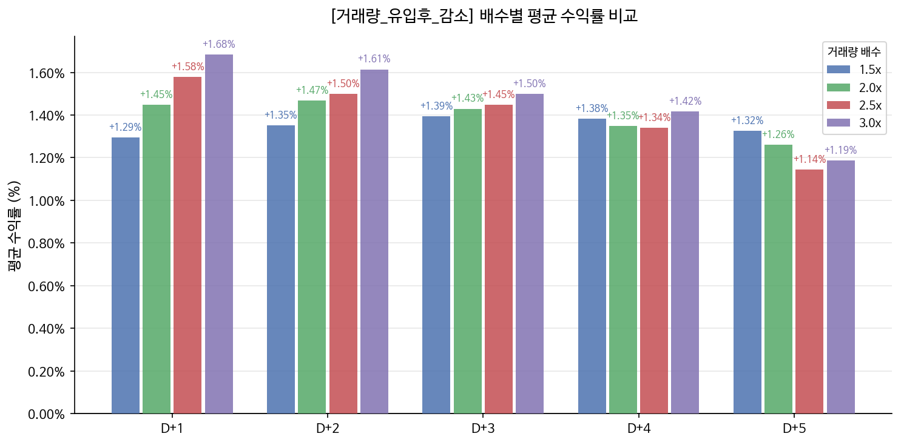
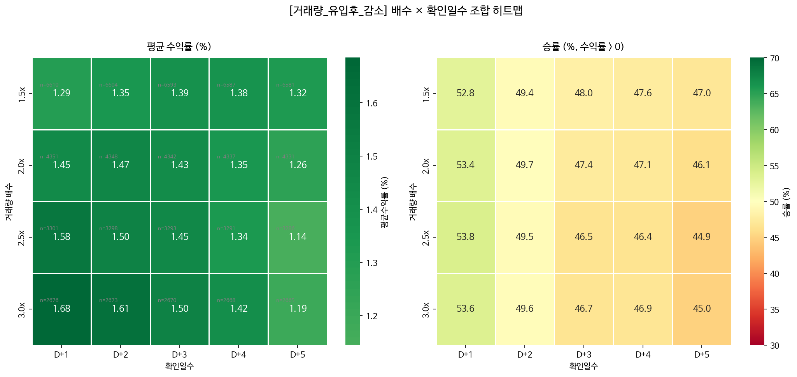

# KRX Volume Pattern Backtester

**국내 주식 거래량 패턴 스크리닝 & 백테스팅 엔진**

코스피/코스닥 전종목 2년치 OHLCV 데이터로 차트 패턴을 자동 감지하고 백테스팅하는 **재사용 가능한 패턴 검색 엔진**입니다.

## 주요 결과: "거래량 유입 후 감소" 패턴 (KOSDAQ, 2024.10 ~ 2026.09)

- 대상: 코스닥 전종목(스팩·우선주 제외), 신호일 거래대금 10억원 미만 제외
- 전체 신호 **17,037건** (배수 1.5 / 2.0 / 2.5 / 3.0배 중복 집계 포함)

매수는 신호 다음날(D+1) 시가 기준이고, 순수익률은 **왕복 거래비용 0.25%**(수수료 + 거래세 + 슬리피지 가정)를 뺀 값입니다.

| 보유 기간 | 평균 수익률 (비용 전) | 평균 수익률 (비용 후) | 승률 (비용 전) | 승률 (비용 후) | 중앙값 (비용 전) | 코스닥 지수 대비 초과수익 |
|---|---|---|---|---|---|---|
| D+1 | +1.45% | **+1.20%** | 53.3% | 52.0% | +0.54% | +1.27%p |
| D+2 | +1.45% | **+1.20%** | 49.5% | 48.3% | 0.00% | — |
| D+3 | +1.43% | **+1.18%** | 47.3% | 46.5% | -0.44% | +1.11%p |
| D+4 | +1.37% | **+1.12%** | 47.1% | 46.2% | -0.56% | — |
| D+5 | +1.25% | **+1.00%** | 46.0% | 45.2% | -0.84% | +0.78%p |

- 비용을 빼도 평균 수익률은 모든 보유 기간에서 플러스입니다.
- 다만 **D+3부터는 중앙값이 마이너스**입니다. 평균이 플러스인 것은 소수의 급등 종목(오른쪽 꼬리) 덕분이므로, 신호 하나하나의 기대값보다는 많은 신호에 분산할 때 의미가 있는 결과입니다.
- 보유 기간이 길어질수록 수익률과 승률이 함께 낮아져, 짧게 보유하는 전략에 더 맞습니다.
- 손절선(-3/-5/-7%)을 걸면 평균 수익률은 거의 그대로이고 승률만 크게 떨어졌습니다. 손절은 수익을 높이기보다 최대 손실을 막는 역할을 합니다. 자세한 수치는 [`data/results/stoploss_summary.json`](data/results/stoploss_summary.json)에 있습니다.

### 거래량 배수별 결과 (D+1 매도 기준)

배수가 높을수록 D+1 평균 수익률이 높아졌습니다.

| 배수 | 신호 수 | 평균 수익률 (비용 전) | 평균 수익률 (비용 후) | 승률 (비용 전) | 승률 (비용 후) |
|---|---|---|---|---|---|
| 1.5x | 6,651 | +1.29% | **+1.04%** | 52.8% | 51.4% |
| 2.0x | 4,380 | +1.45% | **+1.20%** | 53.4% | 52.0% |
| 2.5x | 3,316 | +1.58% | **+1.33%** | 53.8% | 52.6% |
| 3.0x | 2,690 | +1.68% | **+1.43%** | 53.6% | 52.5% |

| 배수별 평균 수익률 | 배수 × 확인일수 히트맵 |
|---|---|
|  |  |

> 수익률은 [`data/results/거래량_유입후_감소_20260911_1412.csv`](data/results/거래량_유입후_감소_20260911_1412.csv)의 누적 수익률(`cum_ret_dN`)로 계산했습니다. 차트는 비용 전 기준입니다. 과거 데이터 백테스트이며 투자 권유가 아닙니다.

## 프로젝트 구조

```
패턴/
├── run_pattern.py          # 메인 실행 진입점
├── manage_patterns.py      # 패턴 목록/관리 CLI
├── requirements.txt
├── patterns/               # 패턴 정의 JSON 저장소
│   └── 거래량_유입후_감소.json
├── src/
│   ├── data_loader.py      # pykrx 데이터 수집 & parquet 캐시
│   ├── universe.py         # 종목 유니버스 필터링
│   ├── pattern_engine.py   # 재사용 패턴 엔진 (핵심)
│   ├── backtest.py         # Forward test & 수익률 계산
│   ├── report.py           # 콘솔 요약 테이블 출력
│   ├── excel_export.py     # 결과 엑셀(요약/상세 시트) 생성
│   ├── chart_export.py     # 차트 PNG 3종 생성
│   └── patterns/
│       ├── base_pattern.py     # 패턴 추상 기반 클래스
│       └── volume_pattern.py   # 거래량 유입후 감소 패턴
├── data/
│   ├── cache/              # OHLCV 캐시 (parquet, 저장소에는 미포함 — --refresh로 생성)
│   └── results/            # 백테스트 결과 (CSV / XLSX / PNG)
└── tests/
    ├── test_pattern_logic.py     # 패턴 감지 로직
    ├── test_export.py            # 엑셀/차트 출력 스모크
    └── test_engine_end_to_end.py # 다운로드 제외 전체 파이프라인
```

## 설치

```bash
pip install -r requirements.txt
```

## 사용법

### 1. 처음 실행 (데이터 다운로드 + 패턴 검색)

```bash
python run_pattern.py --refresh
```

> 초기 전종목 다운로드는 약 30~60분 소요됩니다. 이후 실행은 캐시를 재사용합니다.

### 2. 캐시 재사용 (빠른 재실행)

```bash
python run_pattern.py
```

### 3. 특정 배수만 실행

```bash
python run_pattern.py --multipliers 2.0 3.0
```

### 4. 저장된 패턴 이름으로 실행

```bash
python run_pattern.py --pattern 거래량_유입후_감소
```

### 5. 기간 지정

```bash
python run_pattern.py --start 20240101 --end 20260101
```

### 6. 출력 파일 제어

```bash
python run_pattern.py --no-charts     # 엑셀·CSV만
python run_pattern.py --no-excel      # CSV·차트만
python run_pattern.py --no-save       # 콘솔 출력만 (파일 저장 안 함)
```

---

## 출력 파일 (`data/results/`)

매 실행마다 타임스탬프가 붙어 저장됩니다.

| 파일 | 내용 |
|------|------|
| `{패턴명}_{시각}.csv` | 전체 신호 원본 (배수·종목·신호일·D+1~D+5 수익률) |
| `{패턴명}_{시각}.xlsx` | **요약 시트**(배수×확인일수별 평균수익률/승률/샘플수) + **상세 시트**(전체 신호 리스트, 자동필터) |
| `{패턴명}_histogram_{시각}.png` | D+1·D+3·D+5 수익률 분포 히스토그램 (배수별 색상) |
| `{패턴명}_avg_return_bar_{시각}.png` | 배수별 평균수익률 비교 막대그래프 |
| `{패턴명}_heatmap_{시각}.png` | 배수 × 확인일수 히트맵 (평균수익률 / 승률) |

마지막 실행 요약은 `patterns/{패턴명}.json`의 `last_run` / `last_result_summary`에도 기록됩니다.

---

## 패턴 관리 CLI

```bash
# 저장된 패턴 목록
python manage_patterns.py list

# 패턴 상세 정보
python manage_patterns.py show 거래량_유입후_감소

# 저장된 패턴 재실행
python manage_patterns.py run 거래량_유입후_감소

# 캐시 상태 확인
python manage_patterns.py cache-info

# 패턴 삭제
python manage_patterns.py delete 거래량_유입후_감소
```

---

## 패턴 정의: 거래량 유입후 감소

| 단계 | 조건 |
|------|------|
| **Phase 1 — Day1** | 거래량 > 직전 MA20 × multiplier |
| **Phase 1 — Day2** | 거래량 > Day1 거래량 (더 증가) |
| **Phase 2 — Day3~5** | 거래량이 전일 대비 감소 (양봉/음봉 무관), 최대 3일 |
| **신호일** | Phase2 마지막 날 종가 기준 |

**파라미터 스윕**: `multiplier = [1.5, 2.0, 2.5, 3.0]` 각각 독립 실행 후 비교

---

## 새 패턴 추가 방법

`src/patterns/base_pattern.py`의 `BasePattern`을 상속해서 `detect()` 메서드만 구현하면 됩니다.

```python
from src.patterns.base_pattern import BasePattern

class MyNewPattern(BasePattern):
    name = "내_새_패턴"
    description = "패턴 설명..."
    default_params = {"param1": 값, ...}

    def detect(self, df, **kwargs) -> list:
        # df: 단일 종목 OHLCV (date, open, high, low, close, volume)
        # 신호일 날짜 목록 반환
        signal_dates = []
        # ... 패턴 감지 로직 ...
        return signal_dates
```

---

## 출력 예시

실제 KOSDAQ 실행(2024.10 ~ 2026.09, 비용 전) 결과의 콘솔 요약입니다.

```
======================================================================
[CHART]  백테스팅 결과 요약
======================================================================

[배수 파라미터별 비교 — 평균 수익률]
배수    신호수  D+1 평균  D+2 평균  D+3 평균  D+4 평균  D+5 평균
1.5x    6651   +1.29%   +1.35%   +1.39%   +1.38%   +1.32%
2.0x    4380   +1.45%   +1.47%   +1.43%   +1.35%   +1.26%
2.5x    3316   +1.58%   +1.50%   +1.45%   +1.34%   +1.14%
3.0x    2690   +1.68%   +1.61%   +1.50%   +1.42%   +1.19%

[배수 파라미터별 비교 — 승률(수익률 > 0)]
배수    신호수  D+1 승률  D+2 승률  D+3 승률  D+4 승률  D+5 승률
1.5x    6651   52.8%    49.4%    48.0%    47.6%    47.0%
2.0x    4380   53.4%    49.7%    47.4%    47.1%    46.1%
2.5x    3316   53.8%    49.5%    46.5%    46.4%    44.9%
3.0x    2690   53.6%    49.6%    46.7%    46.9%    45.0%
```

---

## 생존편향 주의사항

현재 구현은 **실행 시점 기준 현존 종목**만 유니버스에 포함합니다.  
2년 내 상폐된 종목은 포함되지 않으므로 실제 성과보다 결과가 다소 좋게 나올 수 있습니다.

---

## 단위 테스트

pykrx / 네트워크 없이 합성 데이터로 전부 실행됩니다.

```bash
python tests/test_pattern_logic.py       # 패턴 감지 로직 (6)
python tests/test_export.py              # 엑셀/차트 출력 스모크 (3)
python tests/test_engine_end_to_end.py   # 엔진→엑셀/차트 전체 흐름 (1)
```
